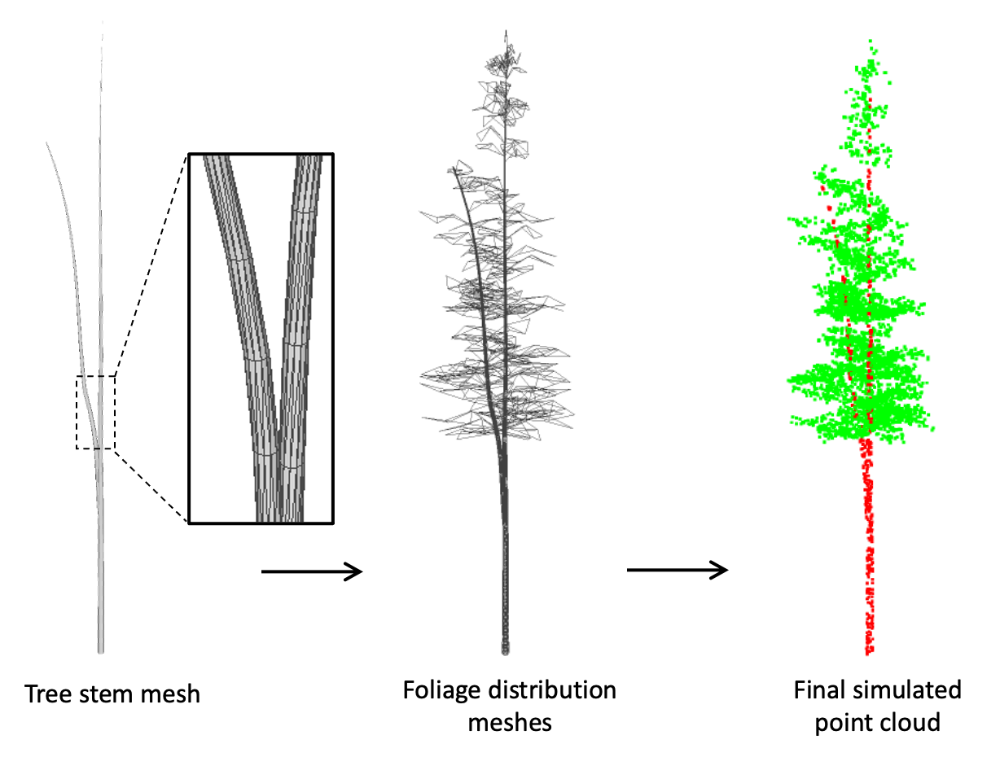
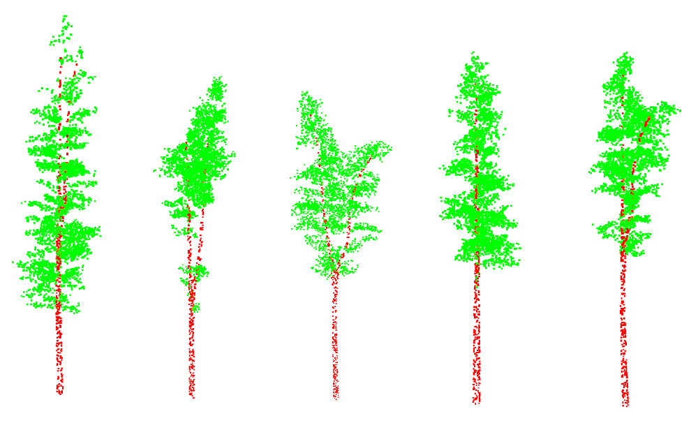

# PlausibiliTree

A pipeline for generating **synthetic forest plots as labelled LiDAR point
clouds**, and for preparing them as ML/DL training data. Each plot
starts from a tree list, becomes a set of per-tree point clouds, is assembled
into a scene with collisions resolved by trimming, and can be extended with
terrain, ground, shrubs and grass. Every stage writes both the point clouds and
the labels an ML pipeline needs: per-point semantics, raster feature/label
pairs, instance masks, skeletons, and info JSONs.

The tree simulator at the core is [Simple Synth Tree](#about--citation)
(`treesim.py`); everything around it is the plot-level pipeline.

## Quickstart

The synthesis workflow is two commands (one if you bring your own tree
tables); training lives in the companion project:

```bash
pip install -r requirements.txt

# 1. (optional) tree lists: raw FIA TREE table -> one canonical plot_<UID>.csv
#    tree list per plot (spec Section 8.1; --format tree-list-json for the
#    JSON form, --format sst-csv for the legacy table)
python fia_helper.py CA_TREE_SMALL.csv -o plots -r 15 --seed 42

# 2. + 3. generate forests and their outputs:
#    per-tree clouds -> assembled plot -> stem/canopy maps -> canonical
#    layout -> (optional terrain + understory) -> info JSONs
python run_pipeline.py plots --radius 15 --seed 42
#    terrain always runs (flat plane by default; --generate-dtm or --dtm
#    for relief), add --understory for shrubs and grass
#    (normalization is out of scope: the DL side owns it)

# 3.+4. cache and train: see the companion project
#    ../SimpleSynthForest-DL  (ae_data build -> train_ae / tune_ae / ...)
```

`python run_pipeline.py plots` alone reproduces the documented defaults once
`plots/` holds `plot_*` tree lists (minimal CSV per plot, or the JSON form;
legacy SST tables still work).
Pass `--seed` consistently across commands you run by hand; the orchestrator
defaults to 42, the stage scripts to 0. `python check.py` sanity-checks the
codebase after any edit.

## How it fits together

```
FIA TREE csv ──fia_helper──▶ plots/plot_<UID>.json       (module 1, optional;
                                   │                      canonical tree list,
                                   │                      --format sst-csv = legacy)
                 generate_trees    │  one labelled cloud per tree, through the
                                   │  generator module contract (sst per -g;
                                   ▼  SST internals in sst_generator.py)
                 assemble_plot     │  rotate + place + collision trimming
                                   ▼
                 stem_map          │  raster features + labels
                 canopy_map        │  (CHM, instance masks, hulls)
                                   ▼
                 restructure       │  flat outputs -> canonical layout
                 terrain (opt.)    │  drape onto DTM, ground points, HAG
                 understory (opt.) │  shrubs + grass
                 build_info        │  plot/tree/shrub info JSONs
                                   ▼
                     plots/plot_<UID>/  (canonical layout, see below)
                                   │
                     (deep learning: the companion project
                      SimpleSynthForest-DL consumes this layout)
```

## The four modules

### 1. Preparing tree lists (optional)

`fia_helper.py` converts a raw FIA `TREE` table into one canonical
`plot_<UID>.csv` tree list per plot (JSON form via `--format tree-list-json`),
ready for generation. Everything downstream reads only those tables, so
you can also write them yourself (see [README_fia_helper.md](README_fia_helper.md))
for the column contract) — FIA data is not required.

- Entry point: `fia_helper.py` — details in [README_fia_helper.md](README_fia_helper.md)
- Environment replicates: `replicate.py` — N copies of a table, each with a
  randomly drawn terrain/shrub/grass sidecar the pipeline applies per plot
  ([README_replicate.md](README_replicate.md))

### 2. Generating trees and plots

`run_pipeline.py` is the front door: it runs every stage per plot, as
subprocesses, with one shared parameter set. Each stage is also a standalone
script with its own `--help` if you need to re-run or hand-tune a single step.

- Orchestrator: [README_run_pipeline.md](README_run_pipeline.md)
- Interactive parameter tuning: `param_editor.py`
  ([README_param_editor.md](README_param_editor.md))
- Per-tree generation: `generate_trees.py` ([README_generation.md](README_generation.md))
- Simulator: `treesim.py` (Simple Synth Tree; see [About](#about--citation))
- Scene assembly + trimming: `assemble_plot.py` ([README_assembly.md](README_assembly.md))
- Optional terrain: `terrain.py` ([README_terrain.md](README_terrain.md)),
  DTM generator `generate_dtm.py`
- Optional understory: `understory.py`
  ([README_understory.md](README_understory.md), shrub outputs in
  [README_shrub_outputs.md](README_shrub_outputs.md))
- Canonical layout move: `restructure.py` ([README_restructure.md](README_restructure.md))

### 3. Labels and outputs for ML/DL

Most of this module runs inside `run_pipeline.py` and lands in the canonical
layout (below). The on-disk vocabulary — per-point dimensions, semantic codes,
file roles — is defined once in [README_schema.md](README_schema.md)
(`schema.py`, `layout.py`); read that before writing a loader.

- Raster labels: `stem_map.py` ([README_stem_map.md](README_stem_map.md)),
  `canopy_map.py` ([README_canopy_map.md](README_canopy_map.md))
- Info JSONs (counts, volumes, neighbourhoods): `build_info.py`
  ([README_build_info.md](README_build_info.md))
- Interactive environment editing: `scene_editor.py` — tune terrain, shrubs
  and grass on already-generated plots and view the result
  ([README_scene_editor.md](README_scene_editor.md))

### 4. Deep learning (companion project)

Training, tuning and diagnostics live in the separate companion project
**SimpleSynthForest-DL** (`../SimpleSynthForest-DL`): `ae_data.py` (cache
building over this project's outputs), `ae_model.py` / `pointbert.py`
(autoencoder + encoders), `train_ae.py`, `tune_ae.py`, `probe_ae.py`,
`diagnose_ae.py`, and the trial tree-count task. It consumes this project's
canonical layout; no synthesis code lives there.

## Output layout

One plot, after `run_pipeline.py`, looks like this (see `layout.py` for the
authoritative key->path mapping, and [README_schema.md](README_schema.md) for
what each file contains):

```
plots/
├── plot_<UID>.csv                   input tree list, one row per tree
│                                    (plot_<UID>.json = alternate JSON form;
│                                    plot_<UID>_report.json = placement
│                                    parameters, incl. plot geometry)
└── plot_<UID>/
    ├── plot_placement/
    │   ├── las/                    plot-level clouds: raw, trimmed, terrain,
    │   │                           understory
    │   ├── textual/                scene JSON (links every artifact), manifest,
    │   │                           info JSON, DTM crop, shrub index
    │   └── deep_learning/          plot-level stem_map / canopy_map
    │                               feature+label rasters
    ├── individual_trees/<TREE_UID>/
    │   ├── las/                    per-tree clouds (same four variants)
    │   ├── textual/                generation + skeleton JSONs, DTM crop
    │   └── deep_learning/          per-tree stem_map / canopy_map
    │                               feature+label rasters
    └── individual_shrubs/<SHRUB_UID>/   shrub clouds + maps (if understory ran)
```

The plot's `*_scene.json` links every artifact with relative paths, so a loader
can start from that one file.

All point clouds are written as **LAZ** (compressed LAS, `.laz` suffix,
via laspy's `lazrs` backend). The path helpers in `layout.py` fall back to
a legacy `.las` file when only that exists, so plots generated before the
switch remain readable without regeneration.

## Documentation index

| Topic | File |
|---|---|
| Feature checklist (what exists, for a rebuild/port) | [CHECKLIST.md](CHECKLIST.md) |
| Demo plot (committed, ready to explore) | [examples/README.md](examples/README.md) |
| Tree lists from FIA | [README_fia_helper.md](README_fia_helper.md) |
| Environment replicates | [README_replicate.md](README_replicate.md) |
| Interactive parameter editor | [README_param_editor.md](README_param_editor.md) |
| Interactive scene editor (terrain/shrubs/grass) | [README_scene_editor.md](README_scene_editor.md) |
| Orchestrator | [README_run_pipeline.md](README_run_pipeline.md) |
| Tree generation | [README_generation.md](README_generation.md) |
| Scene assembly + trimming | [README_assembly.md](README_assembly.md) |
| Stem map | [README_stem_map.md](README_stem_map.md) |
| Canopy map | [README_canopy_map.md](README_canopy_map.md) |
| Canonical layout move | [README_restructure.md](README_restructure.md) |
| Terrain | [README_terrain.md](README_terrain.md) |
| Understory | [README_understory.md](README_understory.md) |
| Shrub outputs | [README_shrub_outputs.md](README_shrub_outputs.md) |
| Info JSONs | [README_build_info.md](README_build_info.md) |
| Point-cloud schema | [README_schema.md](README_schema.md) |
| Deep learning (separate project) | `../SimpleSynthForest-DL/README.md` |

## Requirements

Base (generation + labels): numpy, pandas, laspy, trimesh, scipy, rasterio,
matplotlib — see `requirements.txt`. Training and tuning dependencies (torch,
optuna) belong to the companion deep-learning project.

## About & citation

The tree simulator (`treesim.py`, `generate_example_tree.py`) is a modified
version of **Simple Synth Tree**, the library accompanying:

M. Bryson, F. Wang and J. Allworth, "Using synthetic tree data in deep
learning-based individual tree segmentation using LiDAR point clouds",
*Remote Sensing* 2023, 15(9), 2380.
[https://www.mdpi.com/2072-4292/15/9/2380](https://www.mdpi.com/2072-4292/15/9/2380)




## License

MIT — see [LICENSE](LICENSE). `treesim.py` and
`generate_example_tree.py` contain modified third-party code from Simple
Synth Tree; its provenance and attribution are in
[NOTICE.md](NOTICE.md).
